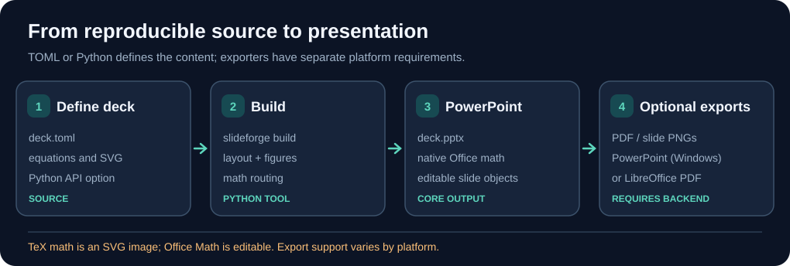

# slideforge

Build PowerPoint decks from Python or a TOML file. Equations become native Office math that
stays editable in PowerPoint, or SVG pictures set by TeX; figures go in as SVG with a PNG
fallback; PowerPoint exports the PDF with its fonts embedded.

## Build pipeline at a glance



An editable presentation is assembled from slide definitions; PDF and slide images need an external office exporter.

Try the repository example after `uv sync`: `uv run slideforge build examples/textbook/deck.toml`. Its figure is generated with `examples/textbook/figures.py` first.

## Install

From a clone of this repository, with [uv](https://docs.astral.sh/uv/):

<!-- test -->
```bash
uv sync
uv run slideforge --help
```

Requirements by feature:

| Feature | Needs |
|---|---|
| Office math equations (`route = "omml"`) | Microsoft Office, for its `MML2OMML.XSL` stylesheet (or the `MML2OMML` variable pointing at a copy) |
| TeX equations (`route = "tex"`) | `xelatex` and `pdftocairo` (MiKTeX or TeX Live with poppler) |
| PDF and PNG export | PowerPoint on Windows; LibreOffice (`soffice`) for PDF only |
| Figures, text, layout | nothing else |

## Use

A deck is a TOML file of settings and slides:

```toml
[math]
route = "omml"
size = 24

[[slide]]
title = "Bessel functions"
[[slide.item]]
math = 'e^{iz\sin\theta} = \sum_{n=-\infty}^{\infty} J_n(z)\,e^{in\theta}'
[[slide.item]]
figure = "bessel.svg"
width = 7
```

```bash
uv run slideforge build examples/textbook/deck.toml    # deck.pptx, deck.pdf, slide PNGs
uv run slideforge math "E=mc^2" "\int_0^1 x\,dx" -o equations.pptx
uv run slideforge export talk.pptx --pdf talk.pdf --png slides/
```

`examples/textbook/` builds a four-slide sample deck; run `examples/textbook/figures.py` first
for its figure. Every setting and its default is in
[`src/slideforge/config.py`](src/slideforge/config.py), the slide items in
[`src/slideforge/deck.py`](src/slideforge/deck.py).

From Python, into a deck built with python-pptx:

```python
from pptx.util import Inches
from slideforge import add_equation, add_figure

add_equation(slide, r"I(\mathbf{Q}) \propto \sum_n J_n(S)^2", left=Inches(1), top=Inches(2), size_pt=24)
add_figure(slide, "map.svg", left=Inches(1), top=Inches(3), width=Inches(6))  # map.png is the fallback
```

## Equations

| Route | Editable in PowerPoint | Fonts | Spacing |
|---|---|---|---|
| `omml` | yes | math fonts installed in Windows (Cambria Math by default) | Office's |
| `tex` | no (SVG picture) | any OpenType math font xelatex finds | TeX's |

The `omml` route converts LaTeX to MathML (latex2mathml), then to Office math with Office's own
stylesheet, and corrects where PowerPoint would set it differently from TeX: function names
(`\sin x`), the operand of sums and integrals (`\sum_n J_n(S)`), bold letters, upright capital
Greek and nabla, and `\,` or `\qquad` spaces.

## Math fonts

PowerPoint sets Office math in fonts installed in Windows, which ships one math font, Cambria
Math. `fonts/fonts.ps1` installs open-licensed math fonts for the current user, without admin
rights, from pinned downloads checked by SHA-256 ([`fonts/fonts.json`](fonts/fonts.json): Fira
Math, Noto Sans Math, GFS Neohellenic Math, Lete Sans Math). `remove` undoes only what `install`
did. Restart PowerPoint after installing.

```powershell
fonts/fonts.ps1 list
fonts/fonts.ps1 install -Font 'Fira Math' -WhatIf
fonts/fonts.ps1 install -Font 'Fira Math'
fonts/fonts.ps1 remove -Font 'Fira Math'
```

Then set `font = "Fira Math"` under `[math]`. The `tex` route needs no installation for fonts
that the TeX distribution has, and `tex_font` can name any font file xelatex finds.

## License

MIT, see [LICENSE](LICENSE).
